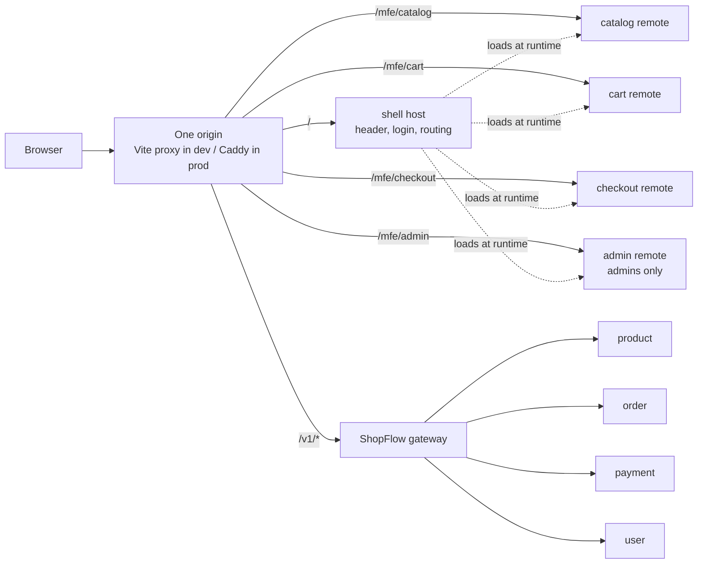

# ShopFlow Web

The web shop for the **[ShopFlow microservices](https://github.com/niravparmar197/shopflow)**, built as **micro frontends**: a shell and 4 remotes (catalog, cart, checkout, admin), joined **at runtime** with Module Federation. Each remote owns one business area, like the backend services.

**Stack:** React 19 · TypeScript (strict) · Vite 8 · Module Federation 2 (`@module-federation/vite`) · React Router 7 · TanStack Query 5 · Tailwind CSS 4 · Vitest · Playwright

> **Status:** F0–F8 done; Phase 2 P1 (admin panel), P2 (address, cancel, ship / deliver) P3 (account) and P4 (GST invoices, policy pages, SES emails) built. **Live on AWS** (Stage 1): https://shopflow-nirav.duckdns.org (when the Stage 1 box is running). Sign up → browse → cart → place order → pay → track.



## Features

| Area | What the user can do |
|---|---|
| Account | Sign up, log in, log out. The session survives a reload (refresh cookie). Guests are sent to login and back. |
| Catalog | Search, filter by category and price (kept in the URL), "Load more", product detail with specifications |
| Cart | Header badge with the live count, change quantity, remove, apply / remove a coupon, totals |
| Checkout | Review and place the order (safe against double clicks), clear messages for price changed, sold out, busy |
| Payment | Countdown to pay; fake provider in dev (Pay / Decline), Razorpay with real keys; waits for the real result |
| Orders | My orders (newest first, "Load more") and a live tracking timeline |
| Resilience | If one part (e.g. the cart) is down, the rest of the page keeps working |

## Apps and packages

| Path | Type | What it owns | Dev port |
|---|---|---|---|
| `apps/shell` | host | Layout, header, login/signup, routing, toasts; loads the remotes | 5000 |
| `apps/catalog` | remote | Home, product list, product detail, "Add to cart" | 5001 |
| `apps/cart` | remote | Cart page + `CartBadge` widget (shown in the shell header) | 5002 |
| `apps/checkout` | remote | Checkout, payment, my orders, order tracking | 5003 |
| `apps/admin` | remote | Admin panel (admin role only): products + images, stock, flash sales, coupons, all orders | 5004 |
| `packages/api` | library | Typed gateway client: token in memory, refresh single flight, `ApiError` | — |
| `packages/ui` | library | Design system: tokens (`theme.css`), Button, Input, Card, Price, StatusPill… | — |
| `packages/shared` | library | Events between apps, `useSession`, routes | — |

## Getting started

### Start everything (every day)

The backend repo has one script that starts the whole stack: Docker infrastructure, the 7 services and this web app, each in its own window. Both repos are side by side in `F:\projects`.

```powershell
cd F:\projects\shopflow
.\scripts\start-all.ps1 -Web ..\shopflow-frontend
```

Wait about 30–60 s, then open **http://localhost:5000**.

| What | URL |
|---|---|
| Web app (shell) | http://localhost:5000 |
| Remotes (dev servers) | :5001 catalog · :5002 cart · :5003 checkout |
| Gateway / API docs | http://localhost:3000 · http://localhost:3000/docs |

Stop everything (data is kept):

```powershell
cd F:\projects\shopflow
.\scripts\stop-all.ps1
```

Only the web app (when the backend is already running): `npm run dev` in this folder.

The first time, do the one-time setup below instead.

### 1. Run the backend first (one-time setup)
Follow **[Run the whole stack locally](https://github.com/niravparmar197/shopflow#run-the-whole-stack-locally-powershell)** in the backend README. You need:
- the gateway on **http://localhost:3000**;
- `FAKE_WEBHOOK_SECRET` set in the payment service's `.env`;
- products seeded **and given stock** (`npm run seed:product`, then `.\scripts\seed-stock.ps1`). Without stock, every order is cancelled as `OUT_OF_STOCK`.

### 2. Run the web app (one-time setup)
Needs Node **22.12+**.

```powershell
npm install
npm run dev        # starts all 5 apps → open http://localhost:5000
```

The shell's dev server sends `/v1/*` to the gateway, so the browser sees one origin.

Gateway on another URL:
```powershell
$env:SHOPFLOW_API="http://localhost:3000"; npm run dev
```

## Start and stop (one command)

| Where | Start | Stop | Check |
|---|---|---|---|
| **Your computer** | `.\scripts\dev.ps1 start` | `.\scripts\dev.ps1 stop` | `.\scripts\dev.ps1 status` |
| **Live (AWS Stage 1)** | `.\scripts\live.ps1 start` | `.\scripts\live.ps1 stop` | `.\scripts\live.ps1 status` |

- **`dev.ps1`** runs `npm run dev` in its own window ("shopflow web"), waits until http://localhost:5000 answers, and warns if the backend (`:3000`) is not running. Backend + web together: `..\shopflow\scripts\start-all.ps1 -Web ..\shopflow-frontend` (and `stop-all.ps1`).
- **`live.ps1`** starts or stops the Stage 1 EC2 box (it runs the backend **and** this web app), then waits until both the shop and the API answer (~3-6 min). `stop` keeps data, certificates and the domain; only compute stops. `live.ps1 open` opens the shop. Needs the AWS CLI profile `shopflow`.

## Scripts

| Command | What it does |
|---|---|
| `npm run dev` | Starts the 5 apps (ports 5000–5004) |
| `npm run build` | Builds the 5 apps, then assembles `dist-web/` in the production layout |
| `npm start` | Serves `dist-web/` on http://localhost:8080 like production (proxies `/v1`) |
| `npm run typecheck` | TypeScript strict, every app and package |
| `npm run lint` | ESLint + the CSS prefix check |
| `npm test` | Unit tests (Vitest) |
| `npm run e2e` | Playwright on the production build (desktop + mobile, mocked gateway) |
| `npm run format` | Prettier |

## How it works

**1. Runtime remotes.** The shell has no remote URLs at build time. At startup it reads `/mfe-manifest.json`:

```json
{ "catalog": "/mfe/catalog/remoteEntry.js", "cart": "/mfe/cart/remoteEntry.js", "checkout": "/mfe/checkout/remoteEntry.js", "admin": "/mfe/admin/remoteEntry.js" }
```

It then registers the remotes with the Module Federation runtime (`apps/shell/src/federation/remotes.ts`). To release one remote, deploy it and change its line in the manifest. To roll back, change the line back. The shell is not rebuilt.

**2. Shared singletons** (`federation.config.ts`). The page loads exactly one copy of each of these:
`react`, `react-dom`, `react-router`, `@tanstack/react-query`, `@shopflow/api`, `@shopflow/shared`.
Two copies of React break hooks, and two copies of `@shopflow/api` would mean two logins.

**3. Failure isolation.** Every remote renders inside `RemoteComponent`: Suspense + an error boundary + "Try again". If the cart remote is down, the cart page shows "The cart is not available right now". The rest of the page keeps working, and the header's cart icon becomes a plain link.

**4. Apps talk by events, not imports** (`packages/shared/src/events.ts`). For example, the catalog adds to the cart, then emits `cart-changed` with `source: 'catalog'`; the cart badge hears it and reloads. A remote ignores its own events, so nothing loads twice. ESLint blocks importing another app's code.

**5. CSS isolation.** Each remote ships its own Tailwind CSS with a **prefix**: `cat:`, `cart:` or `chk:`. Without it, a remote's `.flex-col` (loaded later) would override the shell's `sm:flex-row`. Shared components from `@shopflow/ui` use the shell's unprefixed classes. `npm run lint` fails on a missing prefix.

**6. Auth.** The access token stays in memory only, never in localStorage. The refresh token is the backend's httpOnly cookie (`SameSite=strict`, `path=/v1/auth`), which is why the web app and the API share **one origin**.
On a 401, the client refreshes once (single flight: 10 parallel 401s → 1 refresh, because refresh tokens rotate), then retries the call.

**7. Checkout and payment.**
- **Place order:** `POST /v1/orders` with an `Idempotency-Key` (one per attempt, reused on retry) and `expectedTotalPaise` (the total the user saw). A double click returns the same order; a price change is refused, not charged.
- **Payment row:** it is created when the order is confirmed (stock reserved). The payment page retries for a while, or shows why the order was cancelled.
- **Result:** the browser never decides that a payment worked. The backend webhook does, and the page polls until the status is final.

**8. Eventual consistency, shown honestly.** My orders and tracking come from the order service's read model (CQRS), a few seconds behind. A new order shows "Updating…" until it catches up. The order's items come from the write model, which is always current.

## Pages and API calls

| Route | App | Gateway calls |
|---|---|---|
| `/login`, `/signup` | shell | `POST /v1/auth/login`, `/signup`, `/refresh`, `/logout`, `GET /v1/users/me` |
| `/forgot-password`, `/reset-password#token=…` | shell | `POST /v1/auth/forgot-password`, `/reset-password` (the token sits after `#`, so it never reaches a server log; the page then removes it from the address bar) |
| `/verify-email#token=…` | shell | `POST /v1/auth/verify-email` (sent once, even when React runs the effect twice) |
| `/account` | shell | `PATCH /v1/users/me` (name, phone), `POST /v1/auth/change-password`, `POST /v1/users/me/verify-email` |
| `/privacy`, `/terms`, `/refund-policy`, `/shipping-policy`, `/contact` | shell | none (static pages, linked from the footer; text in `apps/shell/src/pages/legal/content.ts`) |
| `/`, `/products` | catalog | `GET /v1/products?q&category&minPrice&maxPrice&cursor&limit` |
| `/products/:slug` | catalog | `GET /v1/products/:idOrSlug`, `POST /v1/cart/items` |
| `/cart` + header badge | cart | `GET /v1/cart`, `PATCH`/`DELETE /v1/cart/items/:id`, `POST`/`DELETE /v1/cart/coupon` |
| `/checkout` | checkout | `GET /v1/cart`, `GET/POST /v1/users/me/addresses`, `POST /v1/orders` (Idempotency-Key + `shippingAddress`) |
| `/orders/:id/pay` | checkout | `POST /v1/payments/:id/checkout`, `GET /v1/payments/:id`, dev: `POST /v1/payments/dev/fake-pay/:id` |
| `/orders` | checkout | `GET /v1/orders?cursor&limit` |
| `/orders/:id` | checkout | `GET /v1/orders/:id/tracking`, `GET /v1/orders/:id`, `POST /v1/orders/:id/cancel`, `GET /v1/orders/:id/invoice` (PDF, fetched with the token, then saved) |
| `/admin/products` | admin | `GET /v1/products`, `GET /v1/inventory/stock/:id` (per row) |
| `/admin/products/new`, `/admin/products/:id` | admin | `POST /v1/products`, `PATCH /v1/products/:id` (with `version`), images: `POST …/images/upload-url` → upload to storage → `POST …/images/confirm`, `PUT /v1/inventory/stock/:id`, `GET/POST/DELETE /v1/inventory/flash-sales` |
| `/admin/orders`, `/admin/orders/:id` | admin | `GET /v1/admin/orders?status&cursor`, `GET /v1/admin/orders/:id`, `POST …/:id/ship`, `…/deliver`, `…/cancel`, `GET …/:id/invoice` |
| `/admin/coupons` | admin | `GET /v1/coupons`, `POST /v1/coupons` |

All money is in **paise** (integers) and is formatted only at display time (`formatPaise`: 2499900 → ₹24,999).

## Project structure

```
shopflow-frontend/
├── apps/
│   ├── shell/       # host: src/App.tsx (routes), federation/, layout/, pages/
│   ├── catalog/     # remote: pages/, components/, filters.ts, useAddToCart.ts
│   ├── cart/        # remote: CartPage.tsx, CartBadge.tsx, useCart.ts
│   ├── checkout/    # remote: CheckoutPage, PaymentPage, OrdersPage, OrderTrackingPage
│   └── admin/       # remote: products/, orders/, coupons/ (admin role only)
├── packages/
│   ├── api/         # client.ts, auth.ts, endpoints.ts, types.ts, errors.ts
│   ├── ui/          # theme.css, components.tsx, format.ts
│   └── shared/      # events.ts, hooks.ts, routes.ts
├── e2e/             # Playwright tests (mocked gateway)
├── nginx/           # default.conf (cache rules, SPA fallback), security headers
├── scripts/         # dev.ps1 + live.ps1 (start/stop), assemble, serve, size budget, CSS prefix check
├── federation.config.ts   # shared singletons + dev ports
├── Dockerfile             # node build → nginx (non-root)
└── .github/workflows/     # ci.yml, release.yml (image → ECR), deploy-stage1.yml
```

## Troubleshooting

| Problem | Cause and fix |
|---|---|
| Pay page: `404 PAYMENT_NOT_FOUND`, or "This order was cancelled: Out of stock" | The product has no stock. Run `.\scripts\seed-stock.ps1` in the backend, then place a new order. |
| Pay fails with "FAKE_WEBHOOK_SECRET is not set" | Set it in the backend's `apps/payment/.env` and restart the payment service. |
| Logged out after every reload | The web app and `/v1` are not on one origin. Open the app on http://localhost:5000, not on a remote's port. |
| "Too many requests" | The gateway allows 100 requests/min per IP and 5 logins/min. Wait a minute, or raise `RATE_LIMIT_GLOBAL_PER_MIN` in the gateway's `.env` for local work. |
| A part of the page says "not available right now" | That remote's dev server is not running. `npm run dev` starts all 5. |
| `Port 5000 is in use` | Close the other app on that port; the dev ports are set in `federation.config.ts`. |

## Build and deploy

`npm run build` creates `dist-web/` with the same layout production serves:

```
dist-web/
├── index.html, assets/, mfe-manifest.json   # shell
└── mfe/catalog/, mfe/cart/, mfe/checkout/, mfe/admin/   # remotes (remoteEntry.js + assets/)
```

Cache rules (the same in `scripts/serve.mjs` and `nginx/default.conf`):
- **Hashed files** (`assets/*`) are cached for 1 year (`immutable`).
- **`index.html`, `remoteEntry.js` and the manifests** are `no-cache`, so a browser never mixes an old entry with new chunks.
- **App routes** (`/orders/123`) get `index.html`; a **missing file** is a real 404 (never cached).

### Docker image

```powershell
docker build -t shopflow-web .
docker run --rm -p 8080:8080 shopflow-web     # → http://localhost:8080 (UI only, no /v1 proxy)
```
Node 22 builds `dist-web/`, then **nginx** (non-root, port 8080, `/healthz`) serves it. There is no `/v1` proxy in the image: on Stage 1, Caddy sends `/v1` to the gateway.

### Deploy on Stage 1 (AWS)

```
merge to main
  └─ release-image   build → Trivy (fixable CRITICAL/HIGH fail) → ECR shopflow/web:<git sha>
       └─ deploy-stage1   SSM WEB_IMAGE_TAG = <sha> → SSM Run Command → deploy-web.sh on the box
                          → only the web container changes → health check → rollback on failure
```

Live: **https://shopflow-nirav.duckdns.org** (when the Stage 1 box is running). Caddy sends `/v1`, `/health` and `/docs` to the gateway and everything else to this app: one origin, so the login cookie works.

- **Roll back:** Actions → `deploy-stage1` → Run workflow with an older tag (`gh workflow run deploy-stage1 -f tag=<sha>`).
- **GitHub settings** (same values as the backend repo): secrets `AWS_ACCESS_KEY_ID`, `AWS_SECRET_ACCESS_KEY`; variables `AWS_REGION`, `ECR_REGISTRY`, `STAGE1_INSTANCE_ID`, `STAGE1_DOMAIN`; an environment `stage1`.
- **AWS side** (backend repo, Terraform): the ECR repo, the SSM parameter and the box setup. See the backend's [Stage 1 docs](https://github.com/niravparmar197/shopflow/blob/main/docs/deploy-stage1.md#web-app-adr-0007) and ADR 0007.

CI (`.github/workflows/ci.yml`) runs on every PR: typecheck, lint, unit tests, build, bundle size budget, Playwright e2e and `npm audit`.

## Roadmap

- [x] **F0** Foundation: workspaces, packages, shell + 3 remotes, runtime manifest, CI, tests
- [x] **F1** Sign up, log in, log out, session restore, route guard
- [x] **F2** Browse products: grid, search, filters, load more, detail, add to cart
- [x] **F3** Cart: badge with count, cart page, qty, remove, coupon
- [x] **F4** Place order: Idempotency-Key, PRICE_CHANGED / SOLD_OUT / SERVER_BUSY
- [x] **F5** Pay: fake provider (dev), Razorpay adapter, wait for the payment row
- [x] **F6** My orders + live tracking timeline
- [x] **F7** Polish: active nav link, "Page not found" inside remotes, error reference in toasts, pay and mobile orders layout
- [x] **F8** Deploy on Stage 1: Docker (nginx), Caddy route, ECR (Terraform), release (Trivy) + deploy workflows, rollback

### Phase 2 (after F8)

- [x] **P1** Admin panel: the `admin` remote at `/admin/*` (admin role only; customers see "No access"): products with live stock, create / edit (optimistic `version`), image upload, stock, flash sales, coupons, all orders with a status filter
- [x] **P2** Checkout complete: address book + delivery address at checkout, cancel before shipping (refund + stock back), admin ship (courier, tracking) / deliver, tracking shows Shipped / Delivered
- [x] **P3** Account: forgot / reset password by email link, email confirmation (soft: a banner + "send it again"), account page (name, phone, change password)
- [x] **P4** Email and legal: real emails through Amazon SES (backend, opt-in), policy pages (privacy, terms, refund, shipping, contact + grievance officer), GST invoice PDF on the order page and in admin
- [ ] **P5** Shop polish: images in the shop, categories API, sorting, flash sale page, wishlist, reviews

Skipped on purpose: real payments (the fake provider stays) and production extras (backups, custom domain, SEO, uptime).

**Admin panel:** make your user an admin (backend: `UPDATE users SET role='admin' …`, or `seed-live.ps1` on Stage 1), log in again, then use **Admin** in the header. Image upload sends the file straight to storage with a presigned form: it works locally (MinIO) and on Stage 2 (S3); on Stage 1 the storage is private to the box, so uploads fail there.

## License

UNLICENSED — private project.
